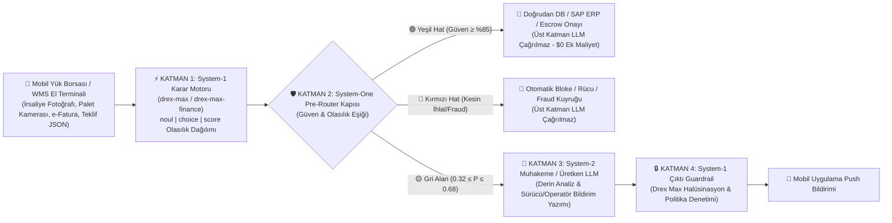
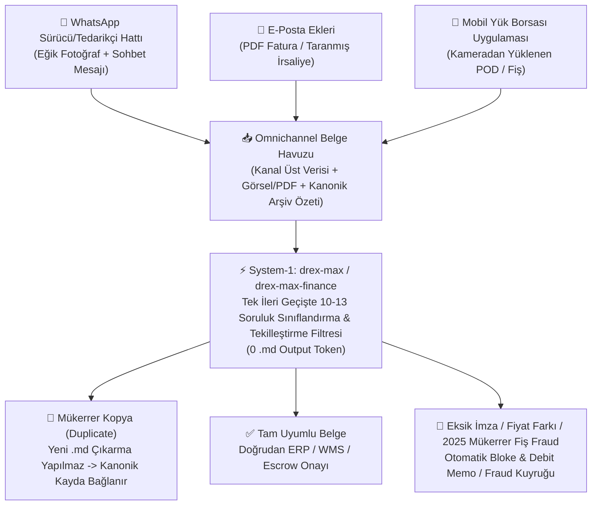

# 🚛 Logi-Playground — Lojistik, Depo (WMS) & Mobil Yük Borsası Çoklu Model Test ve Simülasyon Platformu

**`logi-playground`**, Depo Yönetim Sistemleri (**WMS**), Dijital Navlun / **Mobil Yük Borsası (Freight Exchange)** ve Lojistik Finans operasyonlarında **Karar Modelleri (System-1: `nace-ai/drex-max`, `nace-ai/drex-max-finance`, `nace-ai/drex-v2.0`)** ile **Üretken LLM'lerin (System-2: `gpt-4o-mini`, `gemini-2.5-flash` vb.)** birlikte nasıl çalıştırılacağını test etmek, olasılık/varyasyon analizleri yapmak ve görsel (Vision) yetenekleri simüle etmek için geliştirilmiş kapsamlı bir Python test alanıdır.

---

## 🧠 1. `nace-ai/drex-max` Model İncelemesi ve Kullanım Rehberi

OpenRouter üzerindeki **[`nace-ai/drex-max`](https://openrouter.ai/nace-ai/drex-max)**, Nace.AI tarafından geliştirilen **27 milyar parametreli çok modlu (multimodal) bir karar modelidir (Foundation Decision Model)**.

### 1.1. `nace-ai/drex-max` Klasik LLM'lerden Neden Farklıdır?

Geleneksel sohbet modelleri (`chat/completions`) kelime kelime (token-by-token) metin üretir. Operasyonel yazılımlarda bu durum **JSON parse hatalarına**, **halüsinasyonlara**, **2–5 saniyelik gecikmelere** ve **yüksek çıktı token maliyetine** yol açar.

**`nace-ai/drex-max` ise hiç metin üretmez (`0 output token generation`):**
* **Mimari:** 64 katmanlı yoğun (dense) 27B omurga (**48 Gated DeltaNet** doğrusal dikkat katmanı + her 4 katmanda bir gelen **16 Non-Causal Full-Attention** katmanı) ve sonunda **255-yollu okuma kafası (`255-way readout head`)** bulunur.
* **Tek İleri Geçiş (Single Forward Pass):** Modele bir durum (`state`: metin, JSON veya **4 adede kadar görsel**) ve yapılandırılmış sorular (`questions`) verilir; model tek geçişte her seçenek için **kalibre edilmiş olasılık (`0.0` – `1.0`)** ve **güven (`confidence`)** skoru döndürür.
* **Bağlam Penceresi:** **262,144 token** (262K).
* **Fiyatlandırma:** **$0.06 / 1M girdi token** • **$0.00 / 1M çıktı token**.
* **Benchmark Skorları:**
  * **Public Decision Index 0.4 (Metin):** **`67.52`** (*Tools:* `81.9`, *Language:* `72.2`, *Retrieval:* `68.8`, *Decision Bench v4:* `%94.30`, *JevBench:* `%92.2`)
  * **Public Vision Index (Görsel):** **`73.92`** (*InfographicVQA:* `%97.3`, *KIE CORD+FUNSD Fatura/İrsaliye:* `%92.4`, *Mind2Web UI Navigasyon:* `%84.2`, *CharXiv Grafik:* `%80.5`)

---

### 1.2. `nace-ai/drex-max` API İstek Formatı ve Soru Tipleri (`questions`)

`nace-ai/drex-max`, standart `/api/v1/chat/completions` yerine **OpenRouter Decisions API** veya **TypeSafe System One API** uç noktalarıyla çağrılır:
* `POST https://openrouter.ai/api/alpha/decisions`
* `POST https://openrouter.ai/api/v1/systemone`

İstek gövdesi (`payload`) 3 ana alandan oluşur:
1. **`model`**: `"nace-ai/drex-max"` (veya `"nace-ai/drex-max-finance"`, `"nace-ai/drex-v2.0"`, `"nace-ai/drex-v1.5"`)
2. **`state`**: Değerlendirilecek bağlam:
   * Düz metin (`string`),
   * Yapılandırılmış `JSON` nesnesi (`dict` / `list`),
   * **Görsel (Multimodal) Dizi:** Üst düzey `state` listesi içinde metin ve en fazla 4 adet `{"type": "image_url", "image_url": {"url": "data:image/png;base64,..."}}` öğesi.
3. **`questions`**: İsimlendirilmiş sorulardan oluşan sözlük. Her soru şu **3 tipten** biridir:

| Soru Tipi (`type`) | Ne Sorulur? | Parametreler | Modelin Döndürdüğü Yanıt (`answers`) |
|---|---|---|---|
| **`noul`** | **Evet / Hayır (`True` / `False`)** önermesi | `instructions`: Soru metni<br>*(Opsiyonel)* `criteria`: `{"true": "...", "false": "..."}` | `{"type": "noul", "noul": 0.9984}`<br>*(0 ile 1 arasında "Evet/True" olma olasılığı)* |
| **`choice`** | **Çoktan Seçmeli Sınıflandırma / Yönlendirme** (255 seçeneğe kadar) | `instructions`: Soru metni<br>`criteria`: `{"secenek_a": "Açıklama A", "secenek_b": "Açıklama B"}` | `{"type": "choice", "choice": "secenek_a", "probabilities": {"secenek_a": 0.998, "secenek_b": 0.002}, "confidence": 0.997}` |
| **`score`** | **Sıralı Derecelendirme Ölçeği (Ordinal Rating)** | `instructions`: Soru metni<br>`criteria`: `["Düşük", "Orta", "Yüksek", "Kritik"]` *(Düşükten yükseğe sıralı liste)* | `{"type": "score", "score": 2.91, "legend": {"0": "Düşük", ...}, "probabilities": {"0": 0.001, ...}, "confidence": 0.92}` |

---

### 1.3. `nace-ai/drex-max` Kullanım Örnekleri (Python & cURL)

#### Örnek A: Metin / JSON `state` ile `nace-ai/drex-max` Kullanımı

```python
import os
import requests
from dotenv import load_dotenv

load_dotenv()

payload = {
    "model": "nace-ai/drex-max",
    "state": {
        "load_id": "YUK-88310",
        "route": "Antalya -> Berlin",
        "required_trailer": "Frigo (-18C)",
        "incoming_chat": "Reis uygulama %8 komisyon kesiyor, ilanı iptal et sıfır beş yüz otuz iki... numaradan ara elden IBAN'a at."
    },
    "questions": {
        "commission_circumvention": {
            "type": "noul",
            "instructions": "Is the carrier trying to bypass platform commission by moving payment off-platform?"
        },
        "moderation_action": {
            "type": "choice",
            "instructions": "Which backend action should execute immediately?",
            "criteria": {
                "block_and_warn": "Block chat message, mask phone number, and send policy warning",
                "deliver_message": "Deliver message to shipper normally"
            }
        },
        "violation_severity": {
            "type": "score",
            "instructions": "Rate the severity of the policy violation.",
            "criteria": ["None", "Low", "High", "Critical Ban"]
        }
    }
}

response = requests.post(
    "https://openrouter.ai/api/alpha/decisions",
    headers={
        "Authorization": f"Bearer {os.environ['OPENROUTER_API_KEY']}",
        "Content-Type": "application/json",
    },
    json=payload,
    timeout=30,
)
print(response.json())
```

#### Örnek B: Görsel (Multimodal Vision) `state` ile `nace-ai/drex-max` Kullanımı

`nace-ai/drex-max` modeline görsel göndermek için görsel `base64` data URL (`data:image/png;base64,...`) formatına çevrilir ve **doğrudan üst düzey `state` dizisinin (`list`) içine** yerleştirilir:

```python
import base64
import os
import requests
from pathlib import Path
from dotenv import load_dotenv

load_dotenv()

# 1. Görseli Base64 Data URL olarak hazırla
img_bytes = Path("samples/warehouse_damaged_pallet.png").read_bytes()
b64_img = base64.b64encode(img_bytes).decode("utf-8")

# 2. Üst düzey `state` dizisine metin bağlamı + görsel parçasını (`image_url`) ekle
payload = {
    "model": "nace-ai/drex-max",
    "state": [
        "WMS Dock Policy: Isolate any pallet with undeclared ADR Hazmat labels or liquid spills.",
        {
            "type": "image_url",
            "image_url": {"url": f"data:image/png;base64,{b64_img}"}
        }
    ],
    "questions": {
        "undeclared_adr_detected": {
            "type": "noul",
            "instructions": "Does the pallet image show an ADR Class 3 Flammable label?"
        },
        "putaway_routing": {
            "type": "choice",
            "instructions": "Where should the WMS route this pallet?",
            "criteria": {
                "standard_rack": "Standard High Rack A-12",
                "hazmat_quarantine": "Hazmat Quarantine Bunker & Spill Team",
                "cold_storage": "Cold Storage (-18C)"
            }
        },
        "safety_risk": {
            "type": "score",
            "instructions": "Rate the warehouse safety risk.",
            "criteria": ["Safe", "Low", "High", "Critical Emergency"]
        }
    }
}

resp = requests.post(
    "https://openrouter.ai/api/alpha/decisions",
    headers={"Authorization": f"Bearer {os.environ['OPENROUTER_API_KEY']}"},
    json=payload,
)
print(resp.json())
```

> **📌 Çoklu Görsel İpucu:** Tek bir istekte **4 adede kadar** `{"type": "image_url", ...}` nesnesini aynı `state` listesine ekleyerek `nace-ai/drex-max` modelinin birden fazla fotoğrafı (örneğin *Sevk İrsaliyesi + Rampa Hasar Fotoğrafı + Sıcaklık Grafiği*) çapraz karşılaştırmasını sağlayabilirsiniz. Projedeki [`drex_client.py`](file:///C:/Users/Osman/Desktop/llm-test/drex_client.py) içindeki `encode_image_to_data_url()` ve `evaluate_decision()` fonksiyonları bu işlemi otomatik yapar.

---

## 🏦 2. `nace-ai/drex-max` vs `nace-ai/drex-max-finance` Karşılaştırması

Bu playground içerisinde her iki modeli tek tıkla yan yana (`⚖️ Karşılaştır` butonuyla) test edebilirsiniz:

| Kriter | `nace-ai/drex-max` | `nace-ai/drex-max-finance` |
|---|---|---|
| **Odak Alanı** | Genel çok modlu karar, tarayıcı/UI ajan navigasyonu, depo kamera (WMS) fiziksel hasar & ADR tespiti, IoT grafik okuma, içerik/sohbet moderasyonu | Finansal belgeler, **3-Way Matching (PO – İrsaliye – e-Fatura)**, KDV/Tevkifat denetimi, navlun hak ediş & demuraj sahteciliği, sigorta rücu (subrogation), bilanço/Findeks kredi ve faktoring risk skorlaması |
| **Parametre & Bağlam** | 27B Dense Multimodal • 262K Context | 27B Dense Multimodal (Finans İnce Ayarlı) • 262K Context |
| **Girdi Modalitesi** | Metin, JSON, Görsel (4 adede kadar) | Metin, JSON, Görsel (Fatura, Dekont, İrsaliye, Bilanço) |
| **Fiyatlandırma** | `$0.06 / 1M` girdi • `$0 / 1M` çıktı | `$0.06 / 1M` girdi • `$0 / 1M` çıktı |

---

## 🏗️ 3. Depo (WMS) ve Mobil Yük Borsasında 4-Katmanlı Mimari (System-1 + System-2)

Uygulamalarınız ile LLM'ler arasında `drex-max` ve `drex-max-finance` şu **4 katmanlı mimariyle** konumlandırılır:



---

## 🗂️ 4. Çok Kanallı (WhatsApp + E-Posta + Mobil) Belge Tekilleştirme & Onlarca Soruluk Sınıflandırma Filtresi (`0 .md Token`)

Lojistik ve yük borsası operasyonlarında aynı sefere veya faturaya ait evraklar çoğunlukla **birden fazla kanaldan mükerrer** olarak gelir:
* Sürücü irsaliyeyi **Mobil Uygulamadan** yükler,
* 10 dakika sonra "Garanti olsun" diyerek **WhatsApp Operasyon Grubuna** fotoğrafını atar,
* Nakliye firması aynı evrakı ve kantar fişini **E-Posta** ekinde muhasebeye gönderir.

### 4.1. Klasik `.md` (Markdown) LLM Boru Hattı vs `drex-max` Tek Geçişli Soru Filtresi

| Kriter | ❌ Klasik Mimari (Normal LLM ile `.md` Çıkarma) | ✅ Yeni Mimari (`drex-max` / `drex-max-finance` Soru Filtresi) |
|---|---|---|
| **İşleyiş** | WhatsApp, E-Posta ve Mobil'den gelen her dosyayı ayrı ayrı Vision LLM'e gönderip uzun `.md` (Markdown) metni üretir, sonra başka bir LLM ile JSON'a çevirir. | Tüm kanal üst verisini + belge görselini **tek bir forward pass** içinde değerlendirir. Hiç `.md` metni üretmez (`0 output token`). |
| **Tekilleştirme (Deduplication)** | `.md` metinleri üretildikten sonra regex/embedding ile sonradan yapılmaya çalışılır (3 kat LLM maliyeti). | İlk adımda `q02_is_duplicate_across_channels` (`noul`) ve `q12_dedup_and_ingestion_action` (`choice`) ile mükerrer kopyayı kanonik kayda (`DOC-CANON-...`) bağlar. |
| **Denetim Derinliği** | Serbest metin özetinde imza, kaşe, tevkifat veya plaka karalaması sıkça atlanır (halüsinasyon riski). | Belge sınıfına özel **10 ila 13 yapılandırılmış denetim sorusunu** (`noul` + `choice` + `score`) aynı milisaniyede kalibre olasılıkla yanıtlar. |
| **Gecikme & Maliyet (Canlı Benchmark)** | ~11.400 ms • ~2.850 çıktı token • **~$0.008500 / paket** | **~1.950 – 2.600 ms** • **0 çıktı token** • **~$0.000074 – $0.000129 / paket (66x – 115x Daha Ucuz!)** |



### 4.2. Belge Sınıflarına Göre Örnek Soru Şablonları ([`DOCUMENT_QUESTION_TEMPLATES`](file:///C:/Users/Osman/Desktop/llm-test/drex_client.py#L754-L936))

#### 📦 Paket 1: Sevk İrsaliyesi / POD Tekilleştirme & 13 Soruluk Denetim Şablonu (`sevk_irsaliyesi_pod`)
1. `q01_is_valid_pod_waybill` (`noul`): Yüklenen görsel bir sohbet ekran görüntüsü veya fatura değil, resmi bir **Sevk İrsaliyesi (POD)** mi?
2. `q02_is_duplicate_across_channels` (`noul`): Bu irsaliye (`#IRS-2026-90412`, plaka `34 TRK 882`), saat 14:10'da Mobil Uygulamadan yüklenen `DOC-CANON-90412` kaydının mükerrer kopyası mı?
3. `q03_image_quality_archivable` (`noul`): Görüntü kalitesi ve metin okunabilirliği yasal arşivleme için yeterli mi?
4. `q04_has_shipper_and_origin` (`noul`): Gönderici firma (`Marmara Gıda A.Ş.`) ve çıkış deposu açıkça okunuyor mu?
5. `q05_has_consignee_and_destination` (`noul`): Alıcı firma (`Anadolu Perakende`) ve varış şehri açıkça okunuyor mu?
6. `q06_has_truck_and_trailer_plate` (`noul`): Çekici/dorse plakası (`34 TRK 882 / 34 DRS 19`) belgede yer alıyor mu?
7. `q07_has_receiver_wet_signature` (`noul`): Teslim alan depo sorumlusunun ıslak imzası var mı?
8. `q08_has_official_company_stamp` (`noul`): Alıcı firmanın resmi kaşesi basılmış mı?
9. `q09_has_damage_or_shortage_note` (`noul`): Belge üzerinde **"Hasar / Eksik Şerhi"** (`3 Palet Hasarlı`) notu var mı?
10. `q10_delivered_qty_equals_shipped_qty` (`noul`): Sevk edilen 24 paletin tamamı eksiksiz/hasarsız teslim edilmiş mi?
11. `q11_primary_document_class` (`choice`): Belgenin ana sınıfı nedir? (`sevk_irsaliyesi_pod`, `tedarikci_e_fatura`, `kantar_tartim_fisi`, `otoyol_kopru_dekontu`, `surucu_k1_src_belgesi`)
12. `q12_dedup_and_ingestion_action` (`choice`): Belge işleme hattı ne yapmalı? (`deduplicate_link_to_existing_load_and_hold_escrow` vs `run_full_ocr_markdown_llm_as_new_doc` vs `auto_pay_driver_immediately`)
13. `q13_document_completeness_score` (`score`): Belgenin resmi tamlık puanı (`0 - Unusable` ... `3 - Fully Signed Clean POD`).

#### 📑 Paket 2: E-Posta + WhatsApp Tedarikçi e-Fatura Tekilleştirme & 12 Soruluk 3-Way Matching Şablonu (`tedarikci_e_fatura_3way`)
1. `q01_is_commercial_e_invoice` (`noul`): Birincil belge resmi bir ticari e-Fatura (`#GIB202600091882`) mı?
2. `q02_has_valid_po_reference` (`noul`): Faturada geçerli bir Satınalma Siparişi (`#PO-2026-4401`) referansı var mı?
3. `q03_is_duplicate_invoice_submission` (`noul`): WhatsApp'tan gelen bu fatura fotoğrafı, 8 dakika önce e-postadan işlenen `#GIB202600091882` faturasının mükerrer gönderimi mi?
4. `q04_billed_qty_matches_wms_good_count` (`noul`): Faturalanan miktar (`1.000 palet`), WMS sağlam mal kabul miktarıyla (`850 palet`) uyuşuyor mu?
5. `q05_unit_price_within_2pct_po_contract` (`noul`): Fatura birim fiyatı (`465 TL`), PO sözleşme fiyatının (`400 TL`) `%2` toleransı içinde mi?
6. `q06_declared_weight_matches_weighbridge` (`noul`): Fatura ağırlığı (`22.000 kg`), kantar fişi net ağırlığıyla (`18.700 kg`) uyuşuyor mu?
7. `q07_vat_rate_is_20_percent` (`noul`): Baz KDV oranı `%20` olarak mı hesaplanmış?
8. `q08_mandatory_withholding_tax_applied` (`noul`): Zorunlu `2/10` KDV tevkifatı uygulanmış mı?
9. `q09_requires_debit_memo_for_shortage` (`noul`): 150 eksik palet ve `+65 TL` fiyat farkı için **Debit Memo (Fiyat/Miktar Fark Faturası)** kesilmeli mi?
10. `q10_document_classification` (`choice`): Belge paketinin sınıfı nedir? (`e_fatura_ve_kantar_3way_paketi`, `sevk_irsaliyesi_pod`, `personel_masraf_fisi`)
11. `q11_erp_ingestion_workflow` (`choice`): `.md` çıkarmaya gerek kalmadan hangi ERP akışı tetiklenmeli? (`dedup_merge_and_block_sap_payment`, `approve_and_pay_558000_tl`, `convert_to_markdown_with_llm`)
12. `q12_financial_compliance_score` (`score`): Finansal ve vergisel uyumluluk skoru (`0 - Severe Price/Qty/Tax Violation` ... `3 - 100% Compliant`).

#### 🧾 Paket 3: WhatsApp Sürücü Hattı Kantar/Otoyol Fişi Tekilleştirme & 10 Soruluk Fraud Şablonu (`ek_gider_demuraj_dekont`)
1. `q01_is_expense_or_toll_receipt` (`noul`): Yüklenen görsel ekstra ödeme için sunulan bir kantar/otoyol fişi mi?
2. `q02_is_reused_duplicate_from_old_trip` (`noul`): Bu fiş (`#FIS-2025-11049`), geçmişte 2025 yılındaki başka bir seferde (`#TRIP-2025-109`) kullanılmış mükerrer bir fiş mi?
3. `q03_receipt_date_matches_current_trip` (`noul`): Fiş tarihi (`14.08.2025`) aktif sefer tarihiyle (`10.11.2026`) eşleşiyor mu?
4. `q04_plate_number_matches_active_truck` (`noul`): Fişteki basılı plaka (`06 XYZ 44`), el yazısıyla karalanmadan aktif çekici plakasıyla (`34 ABC 901`) uyuşuyor mu?
5. `q05_shows_visual_tampering_or_crossed_text` (`noul`): Görselde plaka karalaması veya piksel/font manipülasyonu var mı?
6. `q06_gps_waiting_time_exceeds_4_hours` (`noul`): GPS onaylı bekleme süresi (`45 dk`), demuraj hakkı için gereken 4 saatlik (`240 dk`) muafiyeti aştı mı?
7. `q07_base_freight_pod_is_clean` (`noul`): Ana navlun (`32.000 TL`) için temiz imzalı POD mevcut mu?
8. `q08_document_classification` (`choice`): Belge ve talep sınıfı nedir? (`manipule_edilmis_mukerrer_kantar_otoyol_fisi`, `gecerli_otoyol_dekontu`, `yakit_faturasi`)
9. `q09_automated_pipeline_action` (`choice`): Otomasyon hattı ne yapmalı? (`flag_duplicate_fraud_reject_9300_tl_extras`, `approve_all_41300_tl`, `send_to_markdown_ocr`)
10. `q10_fraud_confidence_level` (`score`): Suistimal / mükerrer fiş olasılık derecesi (`0 - Genuine Receipt` ... `3 - Confirmed Multi-Trip Duplicate & Tampered Receipt`).

---

## 🧪 5. Projede Yer Alan 14 Simülasyon Senaryosu ve Varyasyon Laboratuvarı

### A. Çok Kanallı Belge Sınıflandırma & Tekilleştirme Senaryoları (2 Adet)
1. 🗂️ **[Çok Kanallı Tekilleştirme + 13 Soru] WhatsApp, E-Posta & Mobil İrsaliye Sınıflandırma** ([`omnichannel_whatsapp_email_bundle.png`](file:///C:/Users/Osman/Desktop/llm-test/samples/omnichannel_whatsapp_email_bundle.png))
2. 📑 **[Çok Kanallı e-Fatura + 12 Soru] E-Posta & WhatsApp Fatura Tekilleştirme ve 3-Way Filtresi** ([`finance_3way_matching.png`](file:///C:/Users/Osman/Desktop/llm-test/samples/finance_3way_matching.png))

### B. `nace-ai/drex-max-finance` Lojistik Finans Senaryoları (5 Adet)
3. 📑 **Depo Mal Kabul Üçlü Eşleştirme (3-Way Matching: PO – İrsaliye – e-Fatura)** ([`finance_3way_matching.png`](file:///C:/Users/Osman/Desktop/llm-test/samples/finance_3way_matching.png)): 150 palet eksik teslimatı, `+%16.25` birim fiyat aşımını ve eksik `2/10` KDV tevkifatını tek geçişte yakalar.
4. 🕵️ **Navlun Hak Ediş, Demuraj (Bekleme) & Sahte Kantar/Otoyol Fişi Denetimi** ([`finance_demurrage_receipt_fraud.png`](file:///C:/Users/Osman/Desktop/llm-test/samples/finance_demurrage_receipt_fraud.png)): 45 dk'lık gerçek GPS beklemesine rağmen istenen 6.500 TL demurajı ve 2025 tarihli, plakası çizilmiş mükerrer fişi yakalar.
5. ⚖️ **Hasarlı Kargo & Sigorta Rücu (Subrogation) Triyajı (3 Görsel Birden)**: İrsaliye + Rampa ADR/Hasar fotoğrafı + Frigo IoT grafiğini birlikte değerlendirip kusuru Taşıyıcı CMR Sigortası ve Yük Veren ADR Cezası olarak paylaştırır.
6. 🏦 **Vadeli Yük Veren (Açık Hesap) & Faktoring Kredi Risk Skorlaması** ([`finance_credit_balance_sheet.png`](file:///C:/Users/Osman/Desktop/llm-test/samples/finance_credit_balance_sheet.png)): Cari oran (`0.68`), ciro/limit oranı (`%42.6`) ve 3 karşılıksız çeki okuyarak vadeli açık hesabı reddeder.
7. 🧭 **Çoklu Ajan (Multi-Agent) "System One" Ön Yönlendirici (Gri Alan Gatekeeper)**: `+%1.95` kur yuvarlama farkı ve 4 nemli palet içeren sınır vakayı tespit edip `gray_zone_deep_reasoning_llm_queue` kuyruğuna yönlendirir.

### C. `nace-ai/drex-max` Depo (WMS), Lojistik & Mobil Yük Borsası Senaryoları (5 Adet)
8. 🚚 **Mobil Yük Borsası — Sevk İrsaliyesi (POD) & Escrow Denetimi** ([`logistics_pod_waybill.png`](file:///C:/Users/Osman/Desktop/llm-test/samples/logistics_pod_waybill.png))
9. 🏭 **Depo (WMS) Rampa Kabul — Hasarlı Palet & Beyan Edilmemiş ADR Tespiti** ([`warehouse_damaged_pallet.png`](file:///C:/Users/Osman/Desktop/llm-test/samples/warehouse_damaged_pallet.png))
10. 📱 **Mobil Yük Borsası — İlan Şartları (-18°C Frigo & 5M Sigorta) vs Taşıyıcı Teklifi Kalkanı** ([`mobile_load_board_ui.png`](file:///C:/Users/Osman/Desktop/llm-test/samples/mobile_load_board_ui.png))
11. ❄️ **Soğuk Zincir (Frigo) IoT Telemetri Grafiği & Acil Soğuk Depo Yönlendirmesi** ([`cold_chain_telemetry.png`](file:///C:/Users/Osman/Desktop/llm-test/samples/cold_chain_telemetry.png))
12. 🤖 **Mobil Yük Borsası — LLM Öncesi Sohbet & Komisyon Atlatma (Fraud) Kalkanı** (JSON State)

### D. Genel Kurumsal Senaryolar (2 Adet)
13. 🧾 **Kurumsal Bulut Faturası Mükerrer Kalem Denetimi** ([`invoice_audit.png`](file:///C:/Users/Osman/Desktop/llm-test/samples/invoice_audit.png))
14. 🌐 **Tarayıcı Ajanı (Computer Use) 504 Ödeme Hatası Navigasyonu** ([`ui_checkout_error.png`](file:///C:/Users/Osman/Desktop/llm-test/samples/ui_checkout_error.png))

---

## 🛠️ 6. Kurulum ve Çalıştırma

```bash
# 1. Bağımlılıkları yükleyin
pip install -r requirements.txt

# 2. .env dosyasını oluşturun
cp .env.example .env
# OPENROUTER_API_KEY=sk-or-v1-... anahtarınızı ekleyin

# 3. İnteraktif Web Playground'u başlatın (http://localhost:8080)
python app.py

# 4. Çok Kanallı (WhatsApp + E-Posta + Mobil) Belge Tekilleştirme & 10-13 Soruluk Sınıflandırma Simülatörü
python omnichannel_doc_classifier_sim.py

# 5. Drex Max Finance & Olasılık/Varyasyon (Yeşil/Gri/Kırmızı Hat) Simülatörü
python finance_variations_sim.py

# 6. 4-Katmanlı Hibrit (System-1 Drex Max + System-2 LLM) Lojistik Orkestrasyon Simülatörü
python logistics_pipeline_sim.py

# 7. Tüm 14 Görsel & JSON Senaryosunun Benchmark Testi
python cli_demo.py
```
