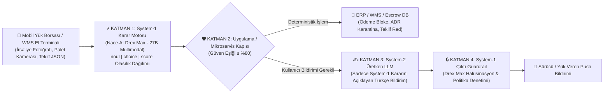

# 🎯 Nace.AI Drex Max — Depo (WMS), Lojistik & Mobil Yük Borsası Karar Playground (`nace-ai/drex-max`)

OpenRouter üzerinde yayınlanan **[Nace.AI: Drex Max (`nace-ai/drex-max`)](https://openrouter.ai/nace-ai/drex-max)** çok modlu karar modelinin (*Multimodal Foundation Decision Model*) **Depo Yönetim Sistemleri (WMS)**, **Lojistik Operasyonları** ve **Mobil Yük Borsası (Freight Exchange)** uygulamalarında **Uygulama ↔ Karar Modeli (System-1) ↔ Üretken LLM (System-2)** katmanları arasında nasıl orkestre edileceğini simüle eden Python Playground ve Benchmark paketi.

---

## 🏗️ Mobil Yük Borsası & Depo Operasyonlarında 4-Katmanlı Mimari (System-1 + System-2)

Geleneksel üretken LLM'ler (GPT-4o, Claude, Gemini) her karar için metin/JSON üretirken **gecikme (2-5 sn)**, **JSON şema kırılması**, **halüsinasyon** ve **yüksek çıktı token maliyeti** yaratır. **Drex Max (`nace-ai/drex-max`)** ise hiçbir metin üretmeden tek ileri geçişte (*single forward pass*, `$0.06/1M girdi`, `$0/1M çıktı`) kalibre edilmiş olasılıklar döndürür:



### Hangi Katmanda Hangi Model Kullanılır?

| Katman | Görev | Kullanılan Model / Teknoloji | Neden? |
|---|---|---|---|
| **1. Mobil Girdi & Belge/Görsel Kapısı (Edge / Ingestion)** | Sürücünün yüklediği **Sevk İrsaliyesi (POD)**, **K1/SRC Belgesi**, **Kantar Fişi** veya **Rampa Palet Fotoğrafı** kontrolü | **`nace-ai/drex-max` (System-1)** | 4 görsele kadar aynı anda okur; ıslak imza/kaşe varlığını, hasar şerhini ve ADR tehlikeli madde etiketini **%99.9+ güvenle** tek geçişte puanlar. |
| **2. Akıllı Eşleştirme, Fiyatlama & Fraud Kalkanı** | Yük ilanı şartları (-18°C Frigo, Sigorta limiti, Tonaj) ile taşıyıcı teklifinin uygunluğu ve komisyon atlatma (sohbette açık telefon/IBAN paylaşımı) tespiti | **`nace-ai/drex-max` / `drex-max-finance`** | Pahalı LLM çağrısına gitmeden `$0.00003` maliyetle uyumsuz teklifi veya platform dışı komisyon kaçırma mesajını anında bloke eder. |
| **3. Doğal Dil Müzakere & Tutanak Yazımı** | System-1'in verdiği kesin kararı sürücüye, yük verene veya sigorta şirketine doğal bir Türkçe metinle açıklamak | **Üretken LLM (System-2)** (`gemini-2.5-flash` / `gpt-4o-mini`) | Karar zaten System-1 tarafından verildiği için LLM karar vermez; yalnızca kararın açıklamasını yazar. |
| **4. Çıktı Denetimi (Output Guardrail)** | Üretken LLM'in yazdığı mesajın yanlışlıkla "ödemeniz hemen yatacak" gibi bir halüsinasyon içerip içermediğini kontrol etmek | **`nace-ai/drex-max` (System-1)** | Push bildirimi çıkmadan önce `faithful_to_system1_decision` (`noul`) olasılığını doğrular. |

---

## 🚛 Depo, Lojistik & Mobil Yük Borsası Simülasyon Senaryoları

Projede **6'sı doğrudan Lojistik, Depo (WMS) ve Mobil Yük Borsası** odaklı olmak üzere toplam **10 hazır senaryo** ve **3 uçtan uca 4-katmanlı hibrit akış** yer alır:

1. 🚚 **Mobil Yük Borsası — Sevk İrsaliyesi (POD) & Hak Ediş (Escrow) Denetimi (`samples/logistics_pod_waybill.png`)**:
   * İrsaliyede alıcı kaşe/imzasını doğrular ancak kırmızı kutudaki **"3 Palet Hasarlı / Tutanakla İade (~14.200 TL)"** şerhini yakalayarak 48.500 TL'lik otomatik ödemeyi bloke eder (`btn_2_hold_escrow_open_damage_claim`).
2. 🏭 **Depo (WMS) Rampa Kabul — Hasarlı Palet & Beyan Edilmemiş ADR Tespiti (`samples/warehouse_damaged_pallet.png`)**:
   * ASN manifestosunda *"Standart Kuru Gıda (Tehlikesiz)"* yazmasına rağmen palet üzerindeki **`ADR Class 3 UN 1263 Flammable`** etiketini ve alt kolideki kimyasal sızıntıyı görsel olarak tespit edip yüksek rafa kaldırmayı engeller (`zone_b_hazmat_quarantine_spill`).
3. 📱 **Mobil Yük Borsası — İlan Şartları vs Taşıyıcı Teklifi Uygunluk Kalkanı (`samples/mobile_load_board_ui.png`)**:
   * `-18°C Frigo Dorse` ve `5.000.000 TL Sigorta` isteyen donuk deniz ürünleri ilanına *"Standart Tenteli Araç (Frigo Yok)"* ve `1.000.000 TL` sigorta ile gelen teklifi reddeder (`btn_2_reject_incompatible`).
4. ❄️ **Soğuk Zincir (Frigo) IoT Telemetri Grafiği & Acil Rota Değişikliği (`samples/cold_chain_telemetry.png`)**:
   * `03:15` kompresör arızası sonrası dorse sıcaklığının `-18°C`'den `+4.5°C`'ye fırladığını grafikten okuyarak aracı 18 km mesafedeki Bolu Soğuk Hava Deposu'na yönlendirir (`reroute_to_bolu_cold_storage`).
5. 🔗 **Çoklu Görsel Lojistik Hasar Dosyası (`logistics_pod_waybill.png` + `warehouse_damaged_pallet.png`)**:
   * Aynı istekte hem şerhli irsaliyeyi hem de rampa kamerasındaki ezilmiş palet fotoğrafını birlikte değerlendirerek sürücünün *"eksiksiz teslim ettim"* iddiasını çürütür.
6. 🤖 **Mobil Yük Borsası — LLM Öncesi Sohbet & Komisyon Atlatma Kalkanı (JSON State)**:
   * Mesajlaşmada yazıyla gizlenmiş telefon numarası (*"sıfır beş yüz otuz iki..."*) ve *"uygulama %8 komisyon kesiyor, ilanı iptal et elden IBAN'a at"* mesajını LLM'e gitmeden yakalar.

---

## 🛠️ Çalıştırma Komutları

```bash
# 1. İnteraktif Web Playground (4-Katmanlı Hibrit Akış + 10 Senaryo + Görsel Stüdyosu)
python app.py
# Tarayıcıda açın: http://localhost:8080

# 2. 4-Katmanlı Hibrit Lojistik & Mobil Yük Borsası Orkestrasyon Simülasyonu (Terminal)
python logistics_pipeline_sim.py

# 3. Tüm 10 Görsel & JSON Senaryosunun Benchmark Testi (Terminal)
python cli_demo.py
```
