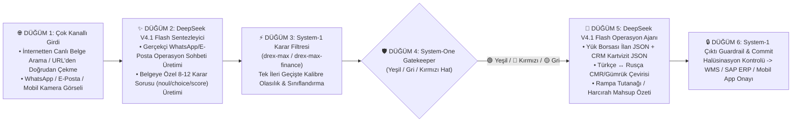

# 🚛 Logi-Playground — Lojistik Operasyon, Mobil Yük Borsası, Depo (WMS) & Lojistik Finans Dinamik Simülasyon Platformu

**`logi-playground`**, Türkiye ve uluslararası lojistik operasyonlarında **Depo Yönetim Sistemleri (WMS)**, **Mobil Yük Borsası (Freight Exchange)**, **Çok Kanallı (WhatsApp / E-Posta / Mobil) Evrak Otomasyonu** ve **Lojistik Finans (3-Way Matching, Demuraj, Harcırah, Kredi Riski)** süreçlerini uçtan uca simüle etmek, dinamik akış diyagramları kurgulamak ve canlı verilerle test etmek için geliştirilmiş bir **İş Modeli ve Operasyon Simülatörüdür**.

> **💡 Mimari Prensip (Modeller Birer Araçtır):** Bu platform bir model incelemesi değil; gerçek lojistik iş süreçlerinin nasıl otomatize edileceğini gösteren bir operasyon motorudur. Yapay zeka modelleri bu iş modelinde doğru katmana yerleştirilmiş **birer araç** olarak görev yapar:
> * ⚡ **Hızlı Karar, Sınıflandırma & Kural Denetim Araçları (System-1 — `0 Output Token`):**
>   * **[`nace-ai/drex-max`](https://openrouter.ai/nace-ai/drex-max)**: WhatsApp/E-posta belge sınıflandırma, tekilleştirme (deduplication), WMS rampa/palet/ADR kontrolü, uluslararası CMR & yükleme checklist (`#CHK-551`) denetimi ve komisyon atlatma (fraud) kalkanı.
>   * **[`nace-ai/drex-max-finance`](https://openrouter.ai/nace-ai/drex-max-finance)**: Depo mal kabulde 3-Way Matching (PO – İrsaliye – e-Fatura), KDV/Tevkifat denetimi, navlun hak ediş & demuraj (bekleme) suistimali, şoför yol masraf fişleri (mazot, HGS, kantar) harcırah mahsubu, sigorta rücu ve vadeli kredi/faktoring risk skorlaması.
> * 🧠 **Üretken Dil, Çeviri, Yapılandırılmış JSON & Dinamik Senaryo Aracı (System-2 LLM):**
>   * **[`deepseek/deepseek-v4.1-flash-1017`](https://openrouter.ai/deepseek/deepseek-v4.1-flash-1017)**:
>     1. **Dinamik Simülasyon Üretimi:** Tek tıkla gerçekçi Türkiye lojistik WhatsApp/E-posta operasyon yazışmaları ve belgeye özel 8–12 adet denetim sorusu (`noul`, `choice`, `score`) sentezleme,
>     2. **Sohbetten Operasyona Dönüştürme (Chat-to-Load & CRM):** WhatsApp yazışmasından **Mobil Yük Borsası İlan JSON'u** ve kartvizit fotoğrafından **CRM Müşteri/VKN Kartı JSON'u** çıkarma,
>     3. **Sınır Ötesi Çeviri (Türkçe ↔ Rusça `Русский язык`):** Sarp / Verkhniy Lars sınır kapısı ve Rusya/BDT koridorunda şoför/gümrük mesajlarını Türkçeye, operasyoncunun Türkçe talimatlarını ise alıcı firma için profesyonel lojistik Rusçasına çevirme,
>     4. **Resmi Tutanak & Mahsup Raporu Yazımı:** System-1 karar modelinin verdiği kesin karara bağlı kalarak depo rampa blokaj tutanağı veya şoför harcırah mahsup tablosu oluşturma.

---

## ⚡ 1. Dinamik Akış & Diyagram Stüdyosu (Visual Flow Builder + `▶ RUN`)

Web arayüzü (`http://localhost:8080`), statik form testleri yerine **dinamik bir operasyon akışı kurgulayıp görsel diyagram üzerinde `▶ RUN SIMULATION` butonuyla çalıştırma** mantığıyla tasarlanmıştır:



### 🌐 İnternetten Canlı Belge Arama ve Dosya Yüklemeden Doğrudan URL ile Test Etme
Sisteme bilgisayarınızdan dosya yüklemek zorunda değilsiniz:
1. **Canlı Web Belge Arama (`🌐 Web'de Belge Ara`):** Arayüz üzerinden `"CMR waybill"`, `"invoice receipt"`, `"bill of lading"`, `"warehouse pallet"`, `"fatura irsaliye"` gibi aramalar yaparak internetteki açık belge görsellerini (Openverse / Wikimedia / GitHub Raw) listeleyebilirsiniz.
2. **Doğrudan URL'den Belge Çekme (`🔗 URL'den Çek & Soruları Üret`):** İnternette bulduğunuz herhangi bir resmi belge, irsaliye, CMR veya fatura görselinin URL'sini yapıştırdığınızda; sistem görseli diske kaydetmeden doğrudan bellekte (`fetch_remote_image_to_data_url`) çeker, boyutlandırır ve **[`deepseek/deepseek-v4.1-flash-1017`](https://openrouter.ai/deepseek/deepseek-v4.1-flash-1017)** ile görseli okuyup **o belgeye özel 8–10 adet denetim sorusunu + WhatsApp operasyon sohbetini otomatik üretir**.
3. **`▶ AKIŞI ÇALIŞTIR (RUN SIMULATION)`:** Tek tıkla diyagramdaki 6 düğüm sırayla çalışır; her düğümün çalışma süresi (`ms`), olasılık çubukları ve üretilen operasyonel çıktılar canlı olarak diyagram altında gösterilir.

---

## 💬 2. Türkiye Lojistik Operasyonlarında WhatsApp & E-Posta Karar Anları

Türkiye'de lojistik operasyonların kalbi WhatsApp gruplarında ve e-posta trafiğinde atar. Platformda bu süreçlerin tamamı için hazır uçtan uca simülasyonlar yer alır:

### 2.1. WhatsApp Sohbetinden Yük İlanı Açma (Chat-to-Load) & Kartvizitten CRM Müşteri Kaydı
* **Saha Gerçeği:** Müşteri veya nakliye komisyoncusu WhatsApp grubuna *"Yarın sabah 08:00 Gebze OSB'den Çorlu Fabrika'ya 22 ton, 33 Euro Palet tekstil kolisi var. 13.60 Tenteli Kayar Perde lazım. 18.000 TL + KDV peşin çalışır. Yeni kartvizitimi de ekte attım CRM'e kaydedersiniz"* yazar ([`whatsapp_load_and_business_card.png`](file:///C:/Users/Osman/Desktop/llm-test/samples/whatsapp_load_and_business_card.png)).
* **Karar Anı ([`nace-ai/drex-max`](https://openrouter.ai/nace-ai/drex-max) — 12 Soru):** Mesaj gerçek bir yük talebi mi? Kalkış/varış, tonaj, palet, dorse tipi ve navlun tam mı? Ekteki fotoğraf VKN'li (`8590412881`) bir kartvizit mi?
* **Üretken Aksiyon ([`deepseek/deepseek-v4.1-flash-1017`](https://openrouter.ai/deepseek/deepseek-v4.1-flash-1017)):** Serbest Türkçe sohbetten **Mobil Yük Borsası İlan JSON'u** ve kartvizit görselinden **CRM Müşteri Kartı JSON'u** çıkartıp müşteriye otomatik WhatsApp teyit mesajı hazırlar.

### 2.2. Uluslararası CMR (TR–RU), Sarp / Verkhniy Lars Gümrük Kapısı & Türkçe ↔ Rusça Çeviri
* **Saha Gerçeği:** Antalya'dan Moskova'ya (`OOO Moskva Agro Trade`) 26 palet narenciye taşıyan `07 TR 992` plakalı tır Verkhniy Lars (Yukarı Lars) gümrüğünde 6 saatlik kuyruğa girer. Şoför Rusça mesaj ve **CMR Taşıma Senedi (`#TR-RU-88412`)** fotoğrafı atar; CMR 18. hanede *"Повреждена стрейч-пленка на 2 паллетах, пломба цела (2 palette dış streç yırtık, gümrük mührü sağlam)"* şerhi vardır ([`whatsapp_cmr_and_warehouse_checklist.png`](file:///C:/Users/Osman/Desktop/llm-test/samples/whatsapp_cmr_and_warehouse_checklist.png)).
* **Karar Anı ([`nace-ai/drex-max`](https://openrouter.ai/nace-ai/drex-max) — 11 Soru):** Belge uluslararası CMR mi? Gümrük mührü (`#TR-994810`) sağlam mı? Gecikme sınır kuyruğundan mı kaynaklanıyor?
* **Üretken Aksiyon ([`deepseek/deepseek-v4.1-flash-1017`](https://openrouter.ai/deepseek/deepseek-v4.1-flash-1017)):** Rus şoförün mesajını ve CMR 18. hane şerhini **Türkçeye**; Türk operasyoncunun talimatını ise Moskova'daki alıcıya gönderilecek **resmi lojistik Rusçasına (`Русский язык`)** çevirir.

### 2.3. Depo (WMS) Mal Kabul & Yükleme Checklist (`#CHK-551`) Rampa Fotoğrafları
* **Saha Gerçeği:** Depo vardiya amiri WhatsApp'tan rampa yükleme checklist formunu ve araç içi fotoğrafı atar: Frigo sıcaklığı (`+3.8°C`) ve koli sayımı (`640 koli`) tamdır, ancak **6 adet olması gereken Spanzet (gerdirme kayışı) yerine sadece 2 adet takılmıştır** ([`whatsapp_cmr_and_warehouse_checklist.png`](file:///C:/Users/Osman/Desktop/llm-test/samples/whatsapp_cmr_and_warehouse_checklist.png)).
* **Karar Anı ([`nace-ai/drex-max`](https://openrouter.ai/nace-ai/drex-max)):** `q07_lashing_straps_spanzet_compliant = HAYIR (%0.15)` ➔ Aracın rampadan çıkışını bloke eder (`hold_dock_for_4_spanzet`).
* **Üretken Aksiyon ([`deepseek/deepseek-v4.1-flash-1017`](https://openrouter.ai/deepseek/deepseek-v4.1-flash-1017)):** Vardiya amiri ve şoföre maddeli **Rampa Çıkış Blokajı ve 4 Ek Spanzet Tamamlama Talimatı** ile WMS JSON tutanağını üretir.

### 2.4. Şoför Yol Masraf Fişleri (Mazot ÖKC, Otoyol/HGS, Kantar vs Farklı Plakalı Market Fişi) & Harcırah Mahsubu
* **Saha Gerçeği:** İstanbul–Mersin (`940 km`) seferini bitiren `34 KLM 482` plakalı çekicinin şoförü WhatsApp'tan 3 fiş fotoğrafı atıp `18.960 TL` ister ([`whatsapp_driver_road_expenses.png`](file:///C:/Users/Osman/Desktop/llm-test/samples/whatsapp_driver_road_expenses.png)).
* **Karar Anı ([`nace-ai/drex-max-finance`](https://openrouter.ai/nace-ai/drex-max-finance) — 9 Soru):**
  1. Opet Pozantı `310 Lt Motorin = 14.260 TL` (`34 KLM 482`, `32.9 lt/100km` norm içi) ➔ **ONAY (`%99.88`)**
  2. Kuzey Marmara Otoyolu + Mersin Kantar = `2.250 TL` (`34 KLM 482`) ➔ **ONAY (`%99.80`)**
  3. Dinlenme Tesisi Market & Sigara Fişi = `2.450 TL` (**Plaka `06 YAB 119` — Başka araç plakası ve sefer öncesi tarih!**) ➔ **RED (`%99.94`)**
* **Üretken Aksiyon ([`deepseek/deepseek-v4.1-flash-1017`](https://openrouter.ai/deepseek/deepseek-v4.1-flash-1017)):** Şoföre WhatsApp'tan gönderilecek kalem kalem **Sefer Harcırah ve Yol Masraf Mahsup Özeti** (`Onaylanan: 16.510 TL`, `Kesinti: -2.450 TL`) mesajını yazar.

---

## 🗂️ 3. Çok Kanallı Belge Tekilleştirme (Deduplication) & 10-13 Soruluk Sınıflandırma Filtresi (`0 .md Token`)

WhatsApp, E-Posta ve Mobil Uygulamadan mükerrer gelen evrakları **normal LLM'lerle `.md` (Markdown) metne dönüştürmek yerine**; tek bir ileri geçişte (**single forward pass**) **tekilleştirme + sınıflandırma + 10-13 soruluk denetim** yapılır:

| Kriter | ❌ Klasik Mimari (Normal LLM ile `.md` Çıkarma) | ✅ `logi-playground` Soru Filtresi Mimarisi |
|---|---|---|
| **İşleyiş** | 3 kanaldan gelen aynı irsaliye/faturayı 3 kez Vision LLM'e gönderip uzun `.md` metni üretir. | Kanal üst verisi + görseli tek geçişte değerlendirir, mükerrer kopyayı kanonik kayda (`DOC-CANON-...`) bağlar (`0 output token`). |
| **Denetim Derinliği** | Serbest metin özetinde eksik imza, tevkifat veya plaka karalaması atlanabilir. | Belge sınıfına özel **10–13 soruyu** (`noul` + `choice` + `score`) aynı milisaniyede kalibre olasılıkla yanıtlar. |
| **Gecikme & Maliyet** | ~11.400 ms • ~2.850 çıktı token • **~$0.008500 / paket** | **~1.950 – 2.600 ms** • **0 çıktı token** • **~$0.000074 – $0.000129 / paket (66x – 115x Daha Ucuz)** |

---

## 🏦 4. Lojistik Finans & Varyasyon/Olasılık Laboratuvarı (`Yeşil Hat` / `Gri Alan` / `Kırmızı Hat`)

Platformda **[`nace-ai/drex-max-finance`](https://openrouter.ai/nace-ai/drex-max-finance)** ile şu 5 ana finansal akış ve **3x3 Olasılık Varyasyon Matrisi** simüle edilir:
1. **Depo Mal Kabulde Üçlü Eşleştirme (3-Way Matching: PO – İrsaliye – e-Fatura)** ([`finance_3way_matching.png`](file:///C:/Users/Osman/Desktop/llm-test/samples/finance_3way_matching.png))
2. **Navlun Pazar Yerinde Hak Ediş, Demuraj (Bekleme) & 2025 Mükerrer Fiş Sahteciliği** ([`finance_demurrage_receipt_fraud.png`](file:///C:/Users/Osman/Desktop/llm-test/samples/finance_demurrage_receipt_fraud.png))
3. **Hasarlı Kargo & Sigorta Rücu (Subrogation) Triyajı (3 Görsel Birden: İrsaliye + Rampa Hasar + Frigo IoT Grafiği)**
4. **Vadeli Yük Veren (Açık Hesap) & Faktoring Kredi Risk Skorlaması** ([`finance_credit_balance_sheet.png`](file:///C:/Users/Osman/Desktop/llm-test/samples/finance_credit_balance_sheet.png))
5. **Çoklu Ajan (Multi-Agent) "System One" Ön Yönlendirici (Gri Alan Gatekeeper):** Rutin evrakların `%85-90`'ını doğrudan onaylar; yalnızca olasılığı `0.35 – 0.65` bandında kalan sınır vakaları (`+%1.95` kur farkı, 4 nemli palet vb.) **[`deepseek/deepseek-v4.1-flash-1017`](https://openrouter.ai/deepseek/deepseek-v4.1-flash-1017)** derin analiz kuyruğuna aktarır.

---

## 🔗 5. İş Modelinde Kullanılan Araçlar (OpenRouter Model Bağlantıları ve API Formatı)

| Rol / Katman | Model Bağlantısı | Girdi / Çıktı | Kullanım Amacı |
|---|---|---|---|
| **System-1 Genel & Saha Karar Motoru** | **[`nace-ai/drex-max`](https://openrouter.ai/nace-ai/drex-max)** | Metin, JSON, Görsel (4 adede kadar) ➔ `noul`, `choice`, `score` olasılıkları (`0 output token`) | WMS rampa kabul, POD irsaliye, CMR, yük borsası eşleştirme, belge sınıflandırma & tekilleştirme |
| **System-1 Lojistik Finans Karar Motoru** | **[`nace-ai/drex-max-finance`](https://openrouter.ai/nace-ai/drex-max-finance)** | Metin, JSON, Görsel ➔ `noul`, `choice`, `score` olasılıkları (`0 output token`) | 3-Way Matching, e-Fatura KDV/Tevkifat, demuraj & fiş sahteciliği, şoför harcırah mahsubu, kredi/faktoring riski |
| **System-2 Üretken LLM, Çeviri & Senaryo Sentezleyici** | **[`deepseek/deepseek-v4.1-flash-1017`](https://openrouter.ai/deepseek/deepseek-v4.1-flash-1017)** | Metin + Görsel (1M Context) ➔ Yapılandırılmış JSON & Çok Dilli Metin | Dinamik WhatsApp sohbet & soru üretimi, Sohbetten Yük/CRM JSON çıkarma, Türkçe ↔ Rusça CMR/Gümrük çevirisi, tutanak yazımı |
| **System-1 Hafif Metin/JSON Karar Motorları** | **[`nace-ai/drex-v2.0`](https://openrouter.ai/nace-ai/drex-v2.0)** / **[`nace-ai/drex-v1.5`](https://openrouter.ai/nace-ai/drex-v1.5)** | Metin, JSON ➔ `noul`, `choice`, `score` | Yüksek hacimli metin/JSON ön filtreleme ve sohbet moderasyonu |

---

## 🛠️ 6. Kurulum ve Çalıştırma

```bash
# 1. Bağımlılıkları yükleyin
pip install -r requirements.txt

# 2. .env dosyasını oluşturun
cp .env.example .env
# OPENROUTER_API_KEY=sk-or-v1-... anahtarınızı ekleyin

# 3. Dinamik Akış & Diyagram Stüdyosu Web Uygulamasını başlatın (http://localhost:8080)
python app.py

# 4. Türkiye WhatsApp/E-Posta Operasyon Karar Anları + DeepSeek V4.1 Flash (TR<->RU Çeviri, Yük & CRM, Rampa Checklist, Yol Fişleri)
python whatsapp_deepseek_ops_sim.py

# 5. Çok Kanallı (WhatsApp + E-Posta + Mobil) Belge Tekilleştirme & 10-13 Soruluk Sınıflandırma Simülatörü
python omnichannel_doc_classifier_sim.py

# 6. Drex Max Finance & Olasılık/Varyasyon (Yeşil/Gri/Kırmızı Hat) Simülatörü
python finance_variations_sim.py

# 7. 4-Katmanlı Hibrit (System-1 Drex Max + System-2 DeepSeek V4.1 Flash) Lojistik Orkestrasyon Simülatörü
python logistics_pipeline_sim.py

# 8. Tüm 17 Görsel & JSON Senaryosunun Benchmark Testi
python cli_demo.py
```
